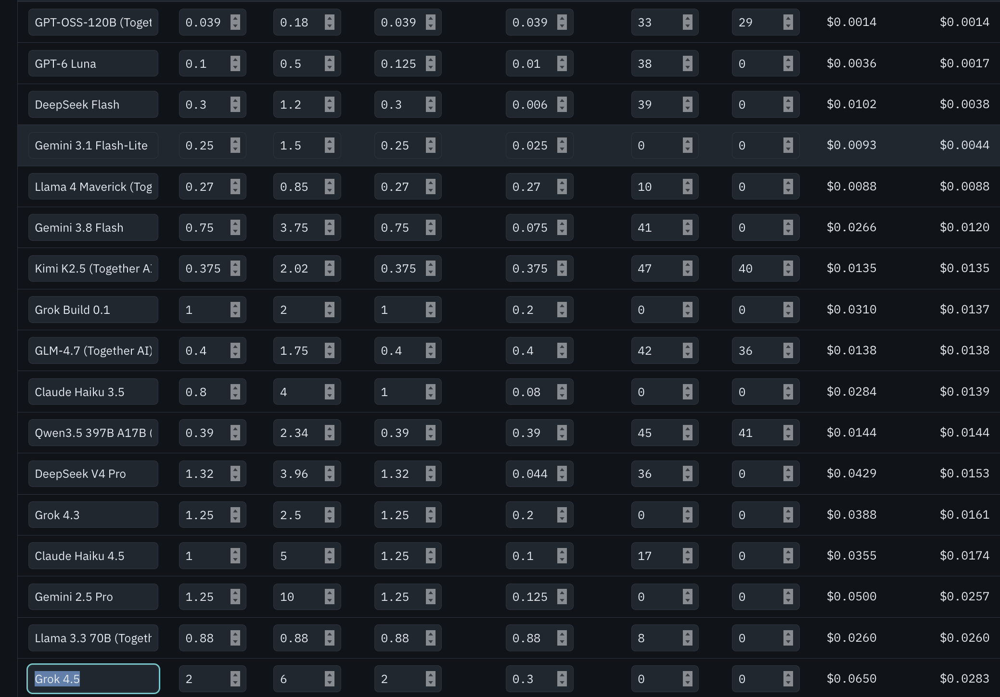

# llm-evals

**LLM Text-to-SQL Eval — IPL 2026**

Given say **₹3 lakh per month** as an LLM budget, which models can I pick to validate my use case?

I made an HTML calculator for that: [`docs/llm_cost_budget_calculator.html`](docs/llm_cost_budget_calculator.html).

Models can also be compared on https://artificialanalysis.ai/leaderboards/models.
These are the models I compared:



Leaderboards measure models in general. This project measures them on **my own task**: turning
English questions about a real database into correct SQL. Every model gets the same questions, and
the SQL it writes is actually run and checked against a known-correct answer.

---

## TL;DR

- **20 models** tested on the **20 hardest questions**, 400 answers in total, all graded automatically.
- **3 models got a perfect 20/20:** Gemini 3.8 Flash, Grok 4.5, Kimi K3.
- **Selected model: GPT-6 Luna, chosen for price.** It scored 19/20 at **$0.0007 per question** and
  about **5 s per answer**. That is about 15× cheaper than the cheapest perfect model, and a
  ₹3 lakh/month budget covers roughly **5 million questions** a month (details in
  [Model selection](#model-selection-gpt-6-luna-for-price)).

---

## Contents

1. [How it works](#how-it-works)
2. [Setup](#setup)
3. [Step 1: Build the database](#step-1-build-the-database)
4. [Step 2: Generate the schema](#step-2-generate-the-schema)
5. [Step 3: The golden dataset](#step-3-the-golden-dataset)
6. [Step 4: Run the models](#step-4-run-the-models)
7. [Step 5: The Excel report](#step-5-the-excel-report)
8. [Results](#results)
9. [Model selection: GPT-6 Luna for price](#model-selection-gpt-6-luna-for-price)
10. [Problems found along the way](#problems-found-along-the-way)
11. [Limitations and next steps](#limitations-and-next-steps)
12. [File reference](#file-reference)

---

## How it works

```
data/ipl/*.csv
    │  generate_db_relational.py      clean the data, add primary + foreign keys
    ▼
ipl_2026_relational.db  ─────────────►  generate_schema.py  ──►  schema.sql (+ schema_er.md)
    │                                                               │
    │  golden_dataset_generator.py   100 questions + correct SQL    │
    ▼                                                               ▼
run_models.py                              (settings, models, question sets: config.py)
    1. run every gold SQL once                → the correct answers
    2. for each model, one after another:
         build the prompt                     prompt.py      (IPL context + schema + question)
         call the model                       openrouter.py  (deadline, retries, out-of-credits)
         extract + run its SQL, compare       grading.py     (read-only, 20 s limit)
    3. save results/model_results.csv after every model
    ▼
make_report.py  ──►  results/eval_report.xlsx   (scoreboard, by-skill, head-to-head, SQL side by side)
```

The core idea is **execution accuracy**: we never compare SQL *text*, only the *results*. Two
differently written queries are equally correct if they return the same data.

---

## Setup

```bash
uv sync                      # installs pandas, httpx, openpyxl, python-dotenv into .venv
```

Create `.env` with your OpenRouter key (either variable name works):

```
OPEN_ROUTER_API_KEY=sk-or-...
```

Always run scripts through `uv run python ...`, which uses the project's `.venv` automatically.

---

## Step 1: Build the database

```bash
uv run python generate_db_relational.py      # -> ipl_2026_relational.db
```

The raw CSVs in `data/ipl/` cover one IPL 2026 season: ball-by-ball deliveries, match results,
squads, venues, the points table and top-15 stat leaderboards. As delivered, they **cannot be
joined reliably**:

| Problem in the raw CSVs | Example | How the loader fixes it |
|---|---|---|
| Teams written three ways | `RCB` / `Royal Challengers Bengaluru` / `Gujrat Titans` (typo) | One `teams` table; everything else stores `team_code` |
| Player names inconsistent | `Rahul` vs `KL Rahul`, `Jadeka`, trailing spaces | One `players` table plus a mapping of 17 alternate spellings; everything else stores `player_id` |
| Same stadium spelled 3 ways | `M.Chinnaswamy Stadium, Bengaluru` vs `M. Chinnaswamy Stadium, Bangalore` | Mapping to one `venue_id`; missing Raipur venue added |
| Results only for some matches | `matches.csv` has 39 games, deliveries has 74 | `matches` has all 74; `match_results` holds the 39 with results |
| Several fielders in one text field | `"A/B"`, `"(sub)X"` | `delivery_fielders` table (many-to-many), with an `is_substitute` flag |
| Over stored as `2.1` | means 3rd over, 1st ball | Extra columns `over_no` (0–19) and `ball_no` |
| Inconsistent wicket names | `runout`, `hitwicket` vs `hit wicket` | One spelling each |

**Primary and foreign keys** are declared in the `CREATE TABLE` statements and enforced during
loading (`PRAGMA foreign_keys = ON`). The loader stops with an error if any player name can't be
resolved, so bad data can't slip in silently. At the end it runs `PRAGMA foreign_key_check`
(0 violations) and cross-checks against the dataset's published facts: Sooryavanshi 776 runs,
KL Rahul 152 highest score.

> **Do you need foreign keys to JOIN?** No. SQL can join any two columns whose values match.
> Foreign keys are integrity rules: they stop rows from pointing at nothing. Here they were worth it
> because the raw data had so many silent mismatches. They also show the model how tables connect
> when included in the prompt.


---

## Step 2: Generate the schema

```bash
uv run python generate_schema.py             # -> schema.sql, schema_er.md
```

`schema.sql` is the database description included in every prompt. It is read from SQLite's own
metadata, so it is never out of date, and contains:

1. **A relationship list** (28 foreign keys), each line showing how two tables join:
   ```
   -- deliveries.bowler_id -> players.player_id   (many-to-one)
   -- match_results.match_id -> matches.match_id   (one-to-one)
   -- delivery_fielders.player_id -> players.player_id   (many-to-many (via junction))
   ```
   The relationship type is worked out automatically. A foreign key that is the table's whole
   primary key means one-to-one. A primary key made entirely of foreign keys means a junction
   (many-to-many) table. Anything else is many-to-one.
2. **Each table's `CREATE TABLE` statement**, plus its row count and 3 sample rows. The sample rows
   show real value formats such as `'3--22'` or `'run out'`. Set `INCLUDE_SAMPLES = False` for a
   harder eval.

`schema_er.md` is the same structure as a Mermaid diagram, which renders on GitHub and in VS Code.

---

## Step 3: The golden dataset

```bash
uv run python golden_dataset_generator.py    # validates all 100 gold queries: "100/100 passed"
```

`golden_dataset_generator.py` holds **100 questions**, each with a hand-written correct ("gold") SQL
query, a difficulty, and skill tags:

| Tier | IDs | What it tests |
|---|---|---|
| easy (20) | 1–20 | Single table, a filter or aggregate, NULL checks |
| medium (35) | 21–55 | Looking up names from ids, 2–3 table joins, LEFT and anti joins |
| hard (30) | 56–85 | The same table joined twice, self-joins, many-to-many, CROSS/FULL joins, window functions |
| brutal (15) | 86–100 | Several traps at once: CTEs + `LAG` + cricket rules + NULL handling |

Skill tags (`join`, `role-join`, `anti-join`, `window`, `null`, `cte`, …) let the report show
**which kinds of SQL** each model is weak at.

**Traps built into the questions**, which is what separates strong models from weak ones:

- `deliveries` refers to players three ways (`striker_id`, `bowler_id`, `player_dismissed_id`).
  "Batter vs bowler" questions need `players` joined twice under different aliases.
- A run out can credit two fielders, so joining `delivery_fielders` and counting rows double-counts.
  Gold 686 vs a careless 700.
- `match_results` covers only 39 of the 74 matches, so an INNER JOIN silently drops 35.
- Match 12 is abandoned but still has 22 balls in `deliveries`. Match 38 had a super over (innings 3–4).
- `wide`, `noballs`, `byes` and `legbyes` are **0/1 flags**; the extra runs themselves are in `extras`.

A tie check was run on every "top 1" question, and tied answers were rewritten to "return all tied",
so no gold answer is ambiguous because of a tie.

**`hardest20`** is a named subset used for cheaper comparison runs: the 10 questions Kimi K3 missed
in its first full run, plus the 10 brutal questions with the most stacked traps (8 hard + 12 brutal).

---

## Step 4: Run the models

```bash
uv run python run_models.py --print-prompt 56                 # see the exact prompt, no API call
uv run python run_models.py --models luna --ids 1 25 56       # cheap test run (3 calls)
uv run python run_models.py --set hardest20 --workers 10      # all models, hardest 20
uv run python run_models.py --selected                        # only the selected model (GPT-6 Luna)
uv run python run_models.py                                   # all models, all 100 questions
```

| Flag | Meaning |
|---|---|
| `--models a b` | Run only models whose name or ID contains `a` or `b` |
| `--selected` | Run only `SELECTED_MODEL` from `config.py` (GPT-6 Luna) |
| `--ids 1 2 3` / `--set hardest20` | Run only these questions |
| `--workers N` | Questions sent at the same time *for one model* (default 25). Models always run one after another |
| `--results x.csv --report x.xlsx` | Write to other files instead of overwriting `results/model_results.csv` / `results/eval_report.xlsx` |

All settings live in `config.py`:
- `MODELS`: 20 models as `(display name, OpenRouter ID)`
- `SELECTED_MODEL`, `QUESTION_SETS`
- token budget, timeouts and retries
- file paths.

### The prompt

**System prompt:** explains the IPL database to the model.
- 10 teams with their codes; 74 matches (league, playoffs, final).
- Names live only in `players` and `teams`.
- Which tables cover the whole season and which don't.
- Cricket conventions in the data: over.ball notation, super-over innings, extras flags.
- Output rules:
  - one ```sql block and nothing else
  - names rather than ids
  - **no `ROUND`**
  - include every tied row when asked.

It describes the data without giving away answers. For example, it never mentions which match was
abandoned.

**User prompt:** `schema.sql`, then the allowed values for every categorical column (read from the
database, e.g. `wicket_type: 'bowled', 'caught', 'run out', …`), then the question.
About 3,800 tokens in total.

### How answers are graded (`compare()` in `grading.py`)

- **Values only:** column names and column order are ignored.
- **Numbers compared numerically to 4 decimals.** `ROUND(x, 2)` therefore fails, which is why the
  prompt forbids it.
- **Row order** is ignored, except for questions marked `ordered=True` (running totals).
- **One extra or missing column is allowed.** "Rabada" and "Rabada, 29" are both correct for
  "who took the most wickets?".
- **Returning an id where a name was asked for fails.**

Each answer gets a `reason`:

| Reason | Meaning |
|---|---|
| `match` | Correct |
| `value_mismatch` | SQL ran, but returned wrong values |
| `row_count …` / `col_count …` | SQL ran, but returned the wrong shape |
| `sql_error` | SQL failed to run |
| `no_sql_in_reply` | No SQL in the reply. If `finish_reason = length`, the model ran out of tokens |
| `api_error` | The API call itself failed |

### Safety and reliability settings

| Setting | Value | Why |
|---|---|---|
| Read-only DB connection | `mode=ro` | Model-written SQL can never change data (a `DELETE` is rejected) |
| `SQL_TIMEOUT_S` | 20 s | Stops runaway queries, e.g. accidental cross joins |
| `MAX_TOKENS` | 16,000 | Reasoning models "think" before answering; 4,000 cut off 8% of Kimi's answers |
| `REQUEST_TIMEOUT_S` | 600 s | A real wall-clock limit per API call (see problems found below) |
| `MAX_RETRIES` | 2 | Retries on rate limits (429), server errors (5xx) and provider failures mid-answer |
| Out of credits (HTTP 402) | Aborts the run | Keeps finished models and discards the partial one, so scores stay comparable |

Results are saved **after every model**, so a crash or a credit problem never loses models that
already finished. Each row records the model's SQL, its result, the gold SQL and result, response
time, token counts and cost.

---

## Step 5: The Excel report

`run_models.py` builds `results/eval_report.xlsx` automatically after every model.
To rebuild a report from one or more results CSVs:

```bash
uv run python make_report.py --input results/model_results.csv --output results/eval_report.xlsx
uv run python make_report.py --input results/full_run.csv results/rerun_q74.csv --output results/combined.xlsx
```

With several inputs, the **later file wins** when the same model and question appear twice. That lets
you re-run a few questions (e.g. after rewording one) and merge them into an earlier run without paying
for the whole run again.

| Sheet | What it shows |
|---|---|
| **Scoreboard** | Ranked models: overall and per-difficulty accuracy, response time, cost, tokens, failure reasons |
| **By Skill** | Accuracy per SQL skill (join, window, anti-join, …) for every model |
| **Head to Head** | Model vs model: questions the row model got right and the column model got wrong |
| **Question Matrix** | PASS/FAIL for every question × model, plus how many models solved each question |
| **Hardest Questions** | The 10 questions the fewest models solved, with the gold SQL to study |
| **SQL Side by Side** | Gold SQL and result next to every model's SQL, result and verdict |
| **All Results** | Every raw row, filterable |

Models are always ordered best-first; percentages are coloured red to green and PASS/FAIL green/red.

---

## Results

### Hardest 20 questions, 20 models (`results/hardest20_20models.xlsx`)

Settings: 16,000-token budget, temperature 0, same prompt for every model.

| Rank | Model | Score | Avg time | Cost / question | Cost (20 q) |
|---|---|---|---|---|---|
| 1 | Gemini 3.8 Flash | **20/20** | 15.0 s | $0.0104 | $0.21 |
| 1 | Grok 4.5 | **20/20** | 14.5 s | $0.0130 | $0.26 |
| 1 | Kimi K3 | **20/20** | 48.9 s | $0.0366 | $0.73 |
| 4 | **GPT-6 Luna** | **19/20** | **5.1 s** | **$0.0007** | **$0.01** |
| 4 | Kimi K2.5 | 19/20 | 95.1 s | $0.0107 | $0.21 |
| 4 | Claude Sonnet 5 | 19/20 | 6.7 s | $0.0194 | $0.39 |
| 4 | GPT-5.6 Terra | 19/20 | 11.4 s | $0.0313 | $0.63 |
| 8 | DeepSeek V4.1 Flash | 18/20 | 9.0 s | $0.0011 | $0.02 |
| 8 | DeepSeek V4 Pro | 18/20 | 23.5 s | $0.0025 | $0.05 |
| 8 | GLM-4.7 | 18/20 | 34.1 s | $0.0052 | $0.10 |
| 8 | Grok Build 0.1 | 18/20 | 26.1 s | $0.0067 | $0.13 |
| 8 | Gemini 2.5 Pro | 18/20 | 31.6 s | $0.0306 | $0.61 |
| 13 | MiniMax M3 | 17/20 | 16.5 s | $0.0016 | $0.03 |
| 13 | Grok 4.3 | 17/20 | 6.4 s | $0.0058 | $0.12 |
| 15 | GPT-OSS-120B | 16/20 | 14.3 s | $0.0004 | $0.01 |
| 15 | Qwen3.5 397B A17B | 16/20 | 30.2 s | $0.0097 | $0.19 |
| 17 | Gemini 3.1 Flash-Lite | 13/20 | 2.2 s | $0.0014 | $0.03 |
| 17 | Claude Haiku 4.5 | 13/20 | 2.8 s | $0.0062 | $0.12 |
| 19 | Llama 4 Maverick | 10/20 | 7.3 s | $0.0009 | $0.02 |
| 20 | Llama 3.3 70B | 8/20 | 10.5 s | $0.0007 | $0.01 |

Claude Haiku 3.5 (from the screenshot) was not tested: Anthropic has retired it, so it is no longer on OpenRouter.

**Most common real mistake:** treating `byes` / `legbyes` as run counts (`extras - byes - legbyes`)
when they are 0/1 flags. 9 models did this even though the prompt says they are flags.
Weaker models also broke the median calculation, filtered out wides entirely, and counted
858 "ducks" instead of 82.

### Full 100 questions, Kimi K3 only (`results/kimi_k3_all100.xlsx`)

90/100 for $1.43: easy 100%, medium 100%, hard 73%, brutal 87%. **None of its SQL was wrong.**
8 misses ran out of the then 4,000-token budget, and 2 were provider errors mid-answer. Both are now
fixed (16,000 tokens, automatic retry). With those fixes Kimi went 20/20 on the hardest set.

---

## Model selection: GPT-6 Luna for price

**Decision: use GPT-6 Luna (`openai/gpt-6-luna`) as the default model for this use case.**

### Why

| | GPT-6 Luna | Cheapest perfect model (Gemini 3.8 Flash) |
|---|---|---|
| Accuracy (hardest 20) | 19/20 (95%) | 20/20 (100%) |
| Cost per question | **$0.0007** | $0.0104 (**15× more**) |
| Avg response time | **5.1 s**, max 8.3 s | 15.0 s, max 57 s |
| Avg output tokens | 391 | 1,877 |

Luna gives up one question out of 20 on the *hardest* set, in exchange for being 15× cheaper and
3× faster than the cheapest perfect scorer. It is also among the most predictable: its slowest answer
took 8.3 s, while the slowest answers of other strong models took 57–330 s. Short answers (391 tokens)
are what keep it cheap and quick.

### What ₹3 lakh/month buys

Assuming ₹85 per US$, ₹3,00,000 ≈ **$3,530 per month**. Using the measured cost per question
(prompt ≈ 3,800 tokens):

| Model | Cost / question | Questions per month for ₹3 lakh |
|---|---|---|
| **GPT-6 Luna** | $0.0007 | **≈ 5,000,000** |
| Gemini 3.8 Flash | $0.0104 | ≈ 340,000 |
| Grok 4.5 | $0.0130 | ≈ 270,000 |
| Kimi K3 | $0.0366 | ≈ 96,000 |

At Luna's price, the budget is not the limit for almost any realistic volume. A different
cost per question changes these numbers; re-check with the calculator HTML using your own token sizes.

### Luna's one miss (Q74, death-overs economy)

Luna subtracted the 0/1 `byes`/`legbyes` flags as if they were run counts, the same mistake 8 other
models made. It also used `over_no BETWEEN 14 AND 19`, which is six overs instead of five; the
"overs 15–19" wording was ambiguous on my side and is now fixed. The flag mistake is a real weakness:
**Luna can misread column meanings that are only explained in the prompt text.**

### Risks and how to handle them

- **Small sample:** 20 questions, so a 1-question gap between models is within noise. Run Luna on all
  100 questions before committing (cost ≈ $0.07):
  `uv run python run_models.py --selected`
- **Accuracy-critical queries:** keep **Gemini 3.8 Flash** as the fallback for money-related or
  user-facing answers. It was the cheapest model with a perfect score.
- **Column meanings:** add column comments to the schema (e.g. "`byes` is a 0/1 flag") rather than
  relying only on the system prompt. This addresses the most common mistake across all models.

---

## Problems found along the way

These were real problems hit while building this. Each is fixed in the code.

| Problem | Cause | Fix |
|---|---|---|
| Every API call hung for 5+ minutes | `langchain-openrouter`'s `ChatOpenRouter` never returned, even for a one-line prompt; plain HTTP answered in 1.4 s | Call OpenRouter directly with `httpx` |
| The "240 s timeout" never fired; calls ran 5+ minutes | `httpx` timeouts limit the *gap between bytes*, and OpenRouter keeps slow requests alive with filler bytes | `post_with_deadline()` enforces a real wall-clock deadline |
| 8% of Kimi answers had no SQL | 4,000 tokens ran out while the model was still "thinking" | Raised `MAX_TOKENS` to 16,000 (`finish_reason = length` shows when it happens) |
| Provider failures scored as wrong answers | HTTP 200 with `finish_reason = error` was not retried | Retried automatically |
| Half the calls failed with HTTP 402 at $2.59 balance | OpenRouter **reserves `max_tokens × price` up front** for every call in flight | Abort the run on 402; use fewer `--workers` when the balance is low |
| All 5 models "failed" Q82 | Question didn't say "regular innings", and the gold excluded the super over | Reworded; after re-running, all 5 got it right |
| 4 models answered Q74 the same "wrong" way | "overs 15–19" can be read as 1-indexed overs | Reworded to "over_no 15–19, i.e. the last five overs" |
| Report crashed with 20 models | No question was solved by ≤ 1 model, so a sheet was empty | Guarded empty sheets; "Hardest" now lists the 10 least-solved questions |

**Lesson:** when every model gets the same question "wrong", check the question first.
Q82 and Q74 were both wording problems on my side, not model failures.

---

## Limitations and next steps

- **20-question sample** for the multi-model comparison; run the full 100 for final decisions.
- **One run per model** at temperature 0. Repeat runs would show how consistent each model is.
- **The original 5 models' hardest-20 answers were reused** from the first run, with only Q82 re-run
  after rewording. That saved money but means they weren't re-run on the reworded Q74.
- **IPL questions stand in for "my use case".** Swap in your own database and questions to validate
  your real workload: rebuild the DB, run `generate_schema.py`, rewrite `GOLDEN`.

---

## File reference

| File | Purpose |
|---|---|
| `data/ipl/*.csv` | Raw IPL 2026 data |
| `generate_db_relational.py` | Raw CSVs → `ipl_2026_relational.db` (cleaned, with primary/foreign keys) |
| `generate_schema.py` | DB → `schema.sql` (prompt text) and `schema_er.md` (ER diagram) |
| `golden_dataset_generator.py` | 100 questions with gold SQL; run it to validate them |
| `config.py` | All settings: paths, token budget, timeouts, `MODELS`, `SELECTED_MODEL`, `QUESTION_SETS` |
| `prompt.py` | System prompt (IPL context and output rules) and user prompt (schema + allowed values + question) |
| `openrouter.py` | OpenRouter HTTP client: wall-clock deadline, retries, `OutOfCredits` |
| `grading.py` | Extract SQL from a reply, run it read-only, compare to gold |
| `run_models.py` | Runs models one by one, saves results after each, prints the scoreboard |
| `make_report.py` | One or more results CSVs → Excel report |
| `results/hardest20_20models.*` | 20 models × hardest 20 (final comparison) |
| `results/kimi_k3_all100.*` | Kimi K3 on all 100 questions (4,000-token budget) |
| `results/model_results.csv`, `results/eval_report.xlsx` | Default output of the next run |
| `docs/llm_cost_budget_calculator.html` | Monthly budget calculator |
| `docs/model_shortlist.png` | Shortlist of models from the calculator |
